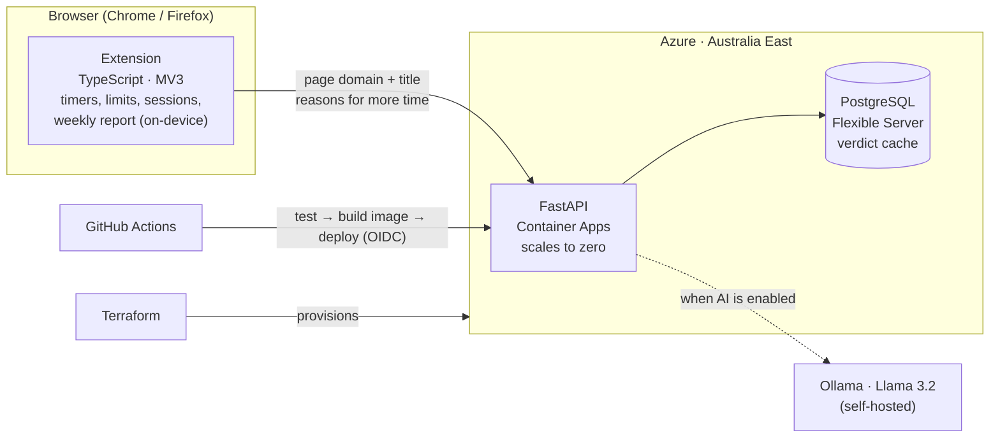

# LockedIn

**A focus extension for students that can tell a lecture from a rabbit hole.**

[](https://github.com/KrishAtGit/LockedIn/actions/workflows/backend.yml)
[](https://github.com/KrishAtGit/LockedIn/actions/workflows/extension.yml)
[](LICENSE)

Most site blockers treat YouTube as one thing. LockedIn looks at the page: a recorded lecture doesn't count toward your limit, Shorts do. When your time runs out, it doesn't just let you click "5 more minutes". It asks **why**, and an AI decides whether the reason holds up.

**Live API:** [lockedin-api…azurecontainerapps.io](https://lockedin-api.whiteocean-2a07b317.australiaeast.azurecontainerapps.io) (interactive docs) · Chrome + Firefox · MV3

## Demo

<!-- Paste your Cursorful video here: open this file in GitHub's editor, drag the .mp4 onto this line, and
     GitHub uploads it and inserts a player link. Keep it under 100 MB (about 1–2 minutes). -->

> 🎥 _Demo video coming soon._

<!-- Screenshots: save these files in docs/screenshots/, then uncomment this block.
<p align="center">
  
  
  
  
</p>
-->

## What it does

| | |
|---|---|
| **Per-site limits** | Tracks active time per site (audible tabs too, so a lecture playing in the background counts) with a daily limit, per-site overrides and a list of study sites that are never limited. |
| **Knows study from distraction** | Each page is labelled study, distraction or neutral. Study pages stop the clock. |
| **"Why?" before more time** | Hitting a limit opens a page where you explain what you need the time for. The AI allows or denies it, and each request makes the next wait longer. |
| **Focus sessions** | Lock in for 25, 50 or 90 minutes. Distractions are blocked outright; ending early takes a written reason and a 15-second wait. |
| **Quiet hours** | Weekly schedules (overnight ones too) that block distractions automatically. Running blocks can't be edited, only skipped with a reason. |
| **Weekly report** | Seven days of studying vs counted time, top sites, sessions kept vs ended early, and every reason you gave. Computed and stored on your device. |
| **Floating timer** | A small, draggable dial on every page. Ring colour shows the AI's label; the numbers turn amber, then red, as time runs out. |

## Architecture



The extension does everything it can locally: time tracking, limits, sessions, schedules and the report never leave your browser. It only calls the API to label a page or judge a reason, and keeps working without it.

## How a page gets labelled

```
request ─▶ rules ─▶ cache (Postgres) ─▶ LLM (Ollama) ─▶ fallback
            │          │                    │
         instant     seen before         down or slow?
                                          → still answers
```

1. **Rules** answer the obvious cases for free: LMS and `.edu` sites, social media, YouTube Shorts, educational video titles.
2. **Cache:** every AI verdict is stored by domain, path and normalised title, so the same page never goes to the model twice. More users means more cache hits.
3. **LLM:** Llama 3.2 3B via Ollama, with output constrained to a JSON schema.
4. **Fallback:** if the model is off, slow or broken, the API still answers from the rules.

**Measured, not assumed.** On a 25-page labelled evaluation set, `llama3.2:3b` gets **24/25 (96%)** with no help from the rules. The first prompt scored 76% once general-interest pages were added (the model called almost anything readable "study"); a stricter definition of study fixed it. Details in [`backend/README.md`](backend/README.md).

## Engineering

- **Infrastructure as code:** Azure Container Apps, PostgreSQL Flexible Server, Log Analytics and a monthly budget alert are all defined in [Terraform](infra/).
- **CI/CD:** every push runs the test suites. Pushes to `main` build a Docker image, push it to GitHub Container Registry, roll it out to Azure and wait for a healthy `/health`.
- **No stored cloud credentials:** GitHub Actions signs in to Azure with OIDC. Azure trusts GitHub's short-lived token only for this repo's `main` branch, and only for this resource group.
- **Costs nothing when idle:** the API scales to zero replicas; a budget alert emails at 50% and 90% of the monthly limit.
- **53 automated tests:** 31 pytest (rules, cache, fallbacks, validation, with a fake model) and 22 Vitest, including timezone- and DST-aware schedule tests run in `Australia/Melbourne`.
- **Privacy by default:** browsing history and analytics stay in the browser; data older than 90 days is deleted automatically.

## Tech stack

| Area | Tools |
|---|---|
| Extension | TypeScript, Manifest V3, Vite, webextension-polyfill, Vitest |
| API | Python, FastAPI, Pydantic, SQLAlchemy (async), Alembic, pytest |
| AI | Ollama, Llama 3.2 3B, JSON-schema constrained output |
| Data | PostgreSQL (asyncpg) |
| Cloud | Azure Container Apps, Azure Database for PostgreSQL, Log Analytics |
| Infra & delivery | Terraform, Docker, GitHub Actions, GitHub Container Registry, OIDC |

## Run it

### The extension

```bash
cd extension
npm install
npm run build        # outputs dist/chrome and dist/firefox
```

<details>
<summary><strong>Load it in Chrome, Edge or Brave</strong></summary>

1. Open `chrome://extensions` and turn on **Developer mode**.
2. Click **Load unpacked** and choose `extension/dist/chrome`.

</details>

<details>
<summary><strong>Load it in Firefox</strong></summary>

1. Open `about:debugging#/runtime/this-firefox`.
2. Click **Load Temporary Add-on** and choose `extension/dist/firefox/manifest.json`.

</details>

### Connect the AI

In the extension's **Settings → AI backend**, turn on **Use the AI backend** and enter a server address:

- **Hosted:** `https://lockedin-api.whiteocean-2a07b317.australiaeast.azurecontainerapps.io` (rules and shared cache).
- **Your own, with the full model:**

  ```bash
  ollama serve                  # terminal 1
  ollama pull llama3.2:3b       # terminal 2, once
  docker compose up --build     # terminal 2: API + Postgres at http://localhost:8000
  ```

Click **Test connection** to check it.

### Deploy your own

```bash
cd infra
cp terraform.tfvars.example terraform.tfvars   # your subscription ID and alert email
terraform init && terraform plan && terraform apply
```

Then set the three `github_variables` outputs as repository variables, and every push to `main` deploys.

## Tests

```bash
cd backend && uv run pytest                              # API
cd backend && uv run python -m scripts.eval_classifier   # model accuracy on the labelled set
cd extension && npm test                                 # extension logic
```

## Project structure

```text
extension/          TypeScript MV3 extension
  src/background.ts   time tracking, limits, sessions, quiet hours, AI labels
  src/content/        floating on-page timer
  src/lib/            schedule, report, storage and timer logic (+ tests)
  src/pages/          popup, settings, blocked page, weekly report
backend/            FastAPI service: rules, cache, Ollama client, evaluation script
infra/              Terraform for Azure
.github/workflows/  CI/CD
docker-compose.yml  API + Postgres for local development
```

## Privacy

- Time tracking, sessions, schedules and the weekly report are stored only in your browser.
- With the AI backend on, the current page's domain, path and title, and any reason you type for more time, are sent to the server you choose. Nothing else is sent.
- The AI backend is off until you turn it on.

## Roadmap

- [ ] Hosted AI for everyone (Ollama on Azure, scaling to zero)
- [ ] Chrome Web Store and Firefox Add-ons release
- [ ] "Wrong label?" feedback, then a small custom classifier trained on it
- [ ] Deadline-aware limits from Canvas, Moodle and Google Calendar

## License

[MIT](LICENSE)
